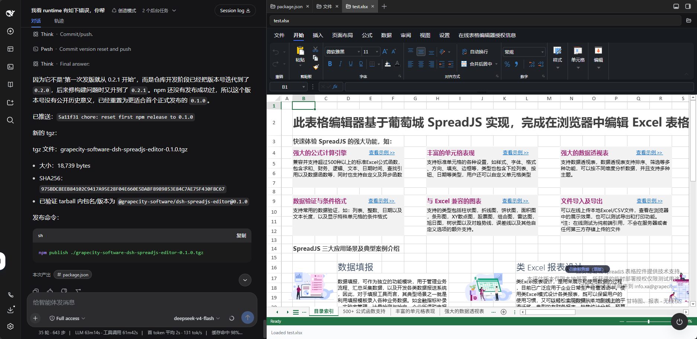

# SpreadJS Editor for DeepSeek Harness

[中文](#中文说明) · [English](#english) · [GitHub](https://github.com/GrapeCityXA/dsh-plugin-spreadjs-editor) · [npm](https://www.npmjs.com/package/@grapecity-software/dsh-spreadjs-editor) · [版本记录 / Changelog](CHANGELOG.md)

在 DeepSeek Harness Web UI 的文件树中打开 Excel / SpreadJS 文件，使用 Designer 编辑并保存回工作区。

Open Excel / SpreadJS files from the DeepSeek Harness Web UI file tree, edit them in Designer, and save back to the workspace.



## 中文说明

### 安装

需要 DSH `>=0.2.1-rc.3 <0.3.0-0`、Node.js ≥22.19。插件内置 SpreadJS 和 Designer `19.2.1`，使用 DSH 自带侧栏，无需额外侧栏插件或本地编译。使用前请确认下方的[授权要求](#授权与配置)。

```sh
dsh plugin --profile web add @grapecity-software/dsh-spreadjs-editor@0.2.9
dsh --profile web
```

安装后重启 DSH，在 Web UI 右侧文件树中打开 `.xlsx`、`.xlsm`、`.csv`、`.sjs` 或 `.ssjson` 文件。

若插件未生效，检查当前 profile 的 `dsh.profile.bundles` 中是否已启用该插件。升级说明见 [CHANGELOG](CHANGELOG.md)。

### 使用与保存

- **保存**：使用文档头部的「保存」或 `Ctrl+S` 写回原文件；「另存为…」写到工作区的另一路径，不覆盖已有文件。
- **冲突保护**：文件加载完成后才能保存；若磁盘文件已被其他程序修改，保存会被拒绝。保存路径必须在当前会话工作区内。
- **未保存改动**：切换或关闭文档时保留恢复快照，重新打开可恢复；磁盘文件已变化时，由用户选择恢复或丢弃。**快照仅在当前页面内存中，刷新或关闭页面后不保留，请及时保存。**
- **界面**：跟随 DSH 明暗主题。Designer 的「设置 → 关于」显示内置版本及授权配置状态；「已配置」不代表授权已验证有效。

Designer 自带的「文件」标签已隐藏，其新建、导入、导出、打印等入口暂不可用。低版本 SpreadJS 可能无法打开本版本保存的 `.sjs` / `.ssjson` 文件，与旧系统交换文件时请保留原文件并确认兼容性。

### 让 AI 操作工作簿（可选）

Editor 可以独立使用。需要 AI 操作工作簿时，将 [SpreadJS Driver](https://github.com/GrapeCityXA/dsh-plugin-spreadjs-driver) 安装到同一个 `web` profile：

```sh
dsh plugin --profile web add @grapecity-software/dsh-spreadjs-driver@0.1.5
```

重启 DSH，在「设置 → 电子表格编辑器」中选择 **SpreadJS Driver**，即可让 AI 打开和修改当前聊天中的工作簿。选择「不使用」可停用 Driver。

AI 改动默认不落盘，可通过工具请求保存或手动保存。执行期间暂停手动编辑；取消不会撤销已产生的改动，已发送的写入仍可能完成。第三方 Driver 接入及执行规则见[桥接契约](docs/bridge-contract.md)。

### 授权与配置

插件代码采用 [MIT 许可证](LICENSE)，**不包含 SpreadJS 或 Designer Component 的商业授权**。两个组件需要分别配置适用的授权；无 key 本地试用仅限供应商试用条款允许的 HTTP(S) 回环环境。正式部署或 SaaS 服务需获取适用于实际场景的授权。

**桌面环境需要同时覆盖 SpreadJS 和 Designer Component 的适用无限制授权；没有该授权，桌面版无法使用本编辑器。** 详见[桌面授权策略](docs/desktop-licensing.md)。

在 `web` profile 的 `cordis.patch.yml` 中更新已有的 `spreadjs-editor` 配置项，保留其他字段：

```yaml
- id: spreadjs-editor
  config:
    licenseKey: 'YOUR_SPREADJS_KEY'
    designerLicenseKey: 'YOUR_DESIGNER_KEY'
```

| 配置项 | 默认值 | 说明 |
| --- | --- | --- |
| `licenseKey` | `''` | SpreadJS 授权 key |
| `designerLicenseKey` | `''` | Designer Component 授权 key |
| `maxSaveBytes` | `67108864` | 单次保存上限，默认 64 MiB；超出时拒绝保存 |
| `trustedHosts` | `[]` | 除回环地址外，额外允许调用保存接口的地址；通过局域网访问时配置 |

修改后重启 DSH 并重新打开文件。`bridge` 由「电子表格编辑器」设置页管理，无需手写。初始化失败时可查看编辑器内的错误提示，修正配置后重新打开文件。

## English

### Installation

Requires DSH `>=0.2.1-rc.3 <0.3.0-0` and Node.js ≥22.19. The plugin bundles SpreadJS and Designer `19.2.1` and uses DSH's built-in sidebar. No additional sidebar plugin or local build is needed. Check the [licensing requirements](#licensing-and-configuration) before use.

```sh
dsh plugin --profile web add @grapecity-software/dsh-spreadjs-editor@0.2.9
dsh --profile web
```

Restart DSH after installation, then open an `.xlsx`, `.xlsm`, `.csv`, `.sjs`, or `.ssjson` file from the Web UI's right-side file tree.

If the plugin does not appear, check that it is enabled in the active profile's `dsh.profile.bundles`. See the [changelog](CHANGELOG.md) for upgrade notes.

### Editing and saving

- **Save**: use **Save** in the document header or `Ctrl+S` to write back to the original file. **Save As…** writes to another workspace path without overwriting an existing file.
- **Conflict protection**: saving requires a fully loaded workbook and a path inside the current session's workspace. If another program has changed the file on disk, the save is refused.
- **Unsaved changes**: switching or closing a document keeps a recovery snapshot. Reopening restores it, or offers Restore / Discard if the disk file has changed. **Snapshots live only in page memory and do not survive a page refresh or close. Save your work promptly.**
- **Interface**: follows DSH's light/dark theme. **Settings → About** in Designer shows bundled versions and license configuration status; a configured key does not establish license validity.

Designer's **File** tab is hidden, so its New, Import, Export, and Print entries are unavailable. Older SpreadJS versions may not open `.sjs` / `.ssjson` files saved by this version; keep originals and check compatibility when exchanging files with older systems.

### Let AI edit workbooks (optional)

The Editor works independently. To let AI operate on workbooks, install the [SpreadJS Driver](https://github.com/GrapeCityXA/dsh-plugin-spreadjs-driver) in the same `web` profile:

```sh
dsh plugin --profile web add @grapecity-software/dsh-spreadjs-driver@0.1.5
```

Restart DSH and select **SpreadJS Driver** under **Settings → Spreadsheet Editor**. AI can then open and edit workbooks in the current chat. Select **None** to disable the Driver.

AI edits are not saved by default; a tool can request a save, or you can save manually. Manual editing is paused during execution. Cancellation does not undo edits already made, and a write already sent may still complete. See the [bridge contract](docs/bridge-contract.md) for third-party integration and execution rules.

### Licensing and configuration

The plugin code uses the [MIT license](LICENSE). **SpreadJS and Designer Component commercial licenses are not included.** Configure applicable license keys for each component. Keyless local evaluation is limited to HTTP(S) loopback environments permitted by the vendor's trial terms. Production and SaaS deployments require licenses appropriate to their use.

**Desktop use requires unrestricted licenses applicable to that environment and covering both SpreadJS and Designer Component. Without them, the editor cannot be used in the desktop app.** See the [desktop licensing policy](docs/desktop-licensing.md).

Update the existing `spreadjs-editor` entry in the `web` profile's `cordis.patch.yml`, preserving its other fields:

```yaml
- id: spreadjs-editor
  config:
    licenseKey: 'YOUR_SPREADJS_KEY'
    designerLicenseKey: 'YOUR_DESIGNER_KEY'
```

| Key | Default | Description |
| --- | --- | --- |
| `licenseKey` | `''` | SpreadJS license key |
| `designerLicenseKey` | `''` | Designer Component license key |
| `maxSaveBytes` | `67108864` | Save size limit, 64 MiB by default; larger saves are refused |
| `trustedHosts` | `[]` | Extra addresses allowed to call the save endpoint beyond loopback; configure for LAN access |

Restart DSH and reopen the file after changing configuration. The **Spreadsheet Editor** settings page manages `bridge`; no manual entry is needed. If initialization fails, review the editor's error message, correct the configuration, and reopen the file.

## 开发 / Development

使用 pnpm 和仓库中的 `pnpm-lock.yaml` 安装依赖。开发依赖固定在 DSH `0.2.1-rc.4`；兼容范围内的 patch / RC 不逐个发版适配，扩展到新的 DSH 次版本前先验证 API 和运行行为。

Install dependencies with pnpm and the committed `pnpm-lock.yaml`. Development dependencies are pinned to DSH `0.2.1-rc.4`. Patch / RC updates within the declared range do not require individual plugin releases. Verify APIs and runtime behavior before extending support to a new DSH minor.

```sh
pnpm install --frozen-lockfile
npm run typecheck
npm test
npm run build
node scripts/smoke-client.mjs
node scripts/smoke-node.mjs
npm run verify:package
```

`npm run probe:live` 可验证运行中 DSH 的真实保存、冲突和工作区边界；运行前需重启 DSH 加载当前构建。支持 `--url`（默认 `http://127.0.0.1:3080`）、`--session`、`--home` 参数，使用 `npm run probe:live -- <参数>` 传入。探针会创建并删除一个临时文件。

`npm run probe:live` checks real saves, conflicts, and workspace boundaries against a running DSH. Restart DSH on the current build first. Pass `--url` (default `http://127.0.0.1:3080`), `--session`, or `--home` via `npm run probe:live -- <options>`. The probe creates and deletes a temporary file.

开发文档 / Development docs: [发布流程 / Release workflow](docs/releasing.md) · [手工回归 / Manual regression](docs/manual-regression.md).
